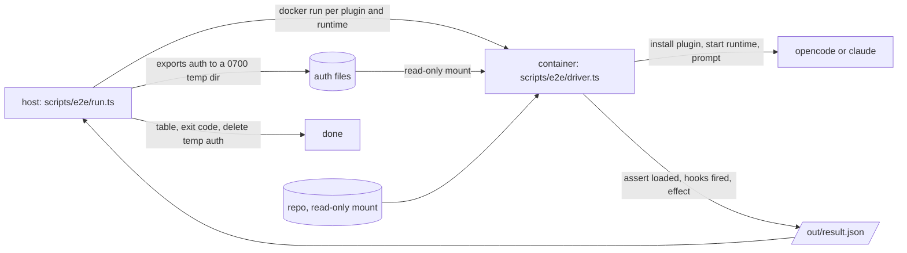

# Plugin end-to-end tests in containers

Every plugin gets a real-runtime test in a clean container: install the plugin the way a user does, start the runtime, check that the plugin loaded, run one cheap prompt, and check that the plugin did its job. Unit tests cover the core; this covers loading, packaging (symlinked `src/shared`, hook commands, manifests) and the real runtimes.

## Flow

## Pieces

| Piece | Where | Job |
| --- | --- | --- |
| Image | `scripts/e2e/Dockerfile` | One image for both runtimes: `node:20-bookworm-slim`, bun, git, jq, python3 (session-self-improve's Claude Code hooks), Claude Code (`npm i -g @anthropic-ai/claude-code`, pinned by `CLAUDE_CODE_VERSION`), opencode (the v2 installer, pinned by `OPENCODE_VERSION`). Both CLIs live in one image because turn-check and task-gh-guard call `opencode run` as their judge, also under Claude Code. Based on the Claude Code reference devcontainer (node base, non-root `node` user). No credentials in any layer |
| Host runner | `scripts/e2e/run.ts` | Builds the image (cached by a Dockerfile+entrypoint hash label), exports auth, runs one container per plugin and runtime the spec declares, prints a results table, deletes the temp auth, exits non-zero when any case fails. Flags: `--plugin <name>` (repeatable), `--runtime opencode\|claude\|all`, `--keep` (keep the out dir), `--no-build`, `--timeout <seconds>` |
| Auth export | `scripts/e2e/auth.ts` | Writes to `mktemp -d` (0700, files 0600), removed in a `finally`. Layout: `opencode.json` (the minimal config), `auth.json`, `claude/.credentials.json`, `claude/oauth-token`; the entrypoint copies each into its `$HOME` path. opencode: copies `~/.local/share/opencode/auth.json` and writes a MINIMAL `opencode.json` that holds only the `provider["fireworks-ai"]` block taken from `~/.config/opencode/opencode.json` (never the user's plugins, MCP servers, agents or other providers). Claude Code: on macOS reads the keychain item `Claude Code-credentials` with `security find-generic-password -s "Claude Code-credentials" -w` and writes `.credentials.json`; on Linux copies `~/.claude/.credentials.json`; `CLAUDE_CODE_OAUTH_TOKEN` in the environment wins when set. Never prints a secret, never passes one on a command line or in `docker run -e` (visible in `ps` and `docker inspect`); files are mounted read-only and the container entrypoint copies them into its fresh `$HOME` |
| Driver | `scripts/e2e/driver.ts` | Runs inside the container as `bun driver.ts <runtime> <plugin>`. Loads `packages/<plugin>/e2e/spec.ts`, installs the plugin, starts the runtime, runs the checks, writes `/out/<plugin>-<runtime>.json` (`{ plugin, runtime, status, checks: [{ name, ok, detail }], logTail }`) |
| Spec type | `scripts/e2e/spec.ts` | `Spec` type (`plugin`, `runtimes`, `prompt`, optional `claude`, `env`, `setup`, `checks`) and a `defineSpec` helper, shared by every plugin |
| Plugin spec | `packages/<plugin>/e2e/spec.ts` | Per plugin: supported runtimes, the prompt, an optional `setup` (container state, e.g. a temp git repo or `~/.agents/AGENTS.md`) and the assertions for loaded and works |
| Notify recorder | `scripts/e2e/notify-recorder.ts` | `AGENTS_NOTIFY_CMD` points at it, so any `notify` call lands in `/out/notify-<plugin>-<runtime>.log` and a check can prove none fired |

## Isolation

- Fresh `$HOME`, `XDG_*` and working directory inside the container. The user's `~/.claude`, `~/.config/opencode`, `~/.agents` and `~/.env` are never mounted.
- The repo is mounted read-only at `/src`; the driver copies it to `/work/agents-plugins` (skipping `node_modules` and `.git`, which are 1.7 GB on the host) so the install and the runtimes can write.
- `--rm`, `--cpus 2`, `--memory 2g`, `--pids-limit 512`, a hard wall-clock timeout per container (default 300 s), no privileged mode, no host network, no docker socket.
- State the plugins write (`SUPERVISOR_HOME`, `TASK_GH_GUARD_STATE_DIR`, `AGENTS_NOTIFY_*`, `~/.agents/plugins/...`) all live in the container home, and `AGENTS_NOTIFY_CMD` points at `scripts/e2e/notify-recorder.ts` so a notify call is visible to the checks instead of showing a desktop notification.

## Install paths (what "loaded" means)

| Runtime | Install | Loaded check |
| --- | --- | --- |
| Claude Code | In the container: `claude plugin marketplace add /work/agents-plugins`, then `claude plugin install <plugin>@<marketplace>`, where `<marketplace>` is the `name` in `.claude-plugin/marketplace.json` (currently `opencode-plugins`; the design originally said `agents-plugins`). This copies the plugin into the cache, so symlinks and missing files in the package show up here | `claude plugin list` shows the plugin enabled with no load error, and a headless run with `--output-format stream-json --verbose --include-hook-events` shows the plugin and its hooks firing: the `system`/`init` event lists `{name, source: "<plugin>@<marketplace>"}`, and each hook event the plugin declares in `hooks/hooks.json` appears as a `system`/`hook_response` with `hook_event` and `outcome: "success"`. Verified on 2.1.283; `SessionEnd` is never emitted by headless `-p` runs, so the driver skips it. The prompt must come before the variadic `--allowedTools` flag or the flag eats it |
| opencode | Add the copied package directory to `plugins` in the minimal `opencode.json` (the same entry the README documents) | An `opencode run --print-logs --log-level debug` run shows `msg="loading plugin" id=<plugin dir> entrypoint=file://<plugin dir>/server.ts` in `$HOME/.local/share/opencode/log/opencode.log` (with the managed service, `--print-logs` prints server logs only with `--standalone`), with no `level=ERROR` line and no `message="failed to load plugin"` line mentioning the plugin dir. A bad v2 default export fails at WARN, so both shapes fail the check. Verified on 2.0.29, which loads only `server.ts`, never the v1 `src/opencode/plugin.ts`, and takes the session directory from `$PWD` rather than the process cwd (the driver sets `PWD` to the run cwd). A plugin that logs nothing is checked through its own side effect instead |

## Cheap prompts

- opencode: `-m fireworks-ai/accounts/fireworks/models/deepseek-v4p1-flash` (the model name carries no `#variant`), prompt "Reply with the single word OK."
- Claude Code: `--model haiku`, `--max-turns 2`, the same prompt, and `--permission-mode` / `--allowedTools` chosen per spec (default: no tools).
- A spec that needs a tool call (task-gh-guard runs `git`) names the one command in the prompt and allows only that tool.
- One prompt per plugin per runtime. Judge calls made by the plugins themselves (turn-check, task-gh-guard review) use their own default model and are part of the "works" check.

## What each plugin asserts

Every spec asserts: the plugin loaded (above), the runtime exited 0, and no `notify` failure was raised (`AGENTS_NOTIFY_CMD` points at a recorder script in the container, and the spec expects it NOT to have been called). Then the plugin-specific "works" checks on an observable effect:

| Plugin | Runtimes | Works check |
| --- | --- | --- |
| task-gh-guard | claude, opencode | The prompt asks the agent to run `git commit --allow-empty -m "add health check"` in a temp repo. `review.jsonl` in the state dir has an entry for that command with decision `allow`, and `~/.agents/plugins/task-gh-guard/{model,rules}` exist with defaults |
| turn-check | claude, opencode | After the run, `audits.jsonl` in `SUPERVISOR_HOME` gains an entry for the session (an audit ran with the real judge) with a verdict or a logged error that the spec reports as a failure. Claude Code audits in a detached child, so poll up to 120 s |
| overhelm | claude, opencode | Setup writes a marker instruction into `~/.agents/overhelm.md`; the prompt asks the model to repeat its standing instructions, so the marker appearing in the run output proves the injection ran |
| session-index | opencode | The spec env shortens `OPENCODE_SESSION_INDEX_IDLE_MS`; after the run the row for the session (its folder is the run cwd) is polled for in `~/.agents/sessions.csv` |
| session-self-improve | claude, opencode | The prompt carries a `from now on` rule cue; a queue record with kinds `["rule"]` appears under `~/.claude/session-self-improve/queue` (Claude Code) or `~/.cache/session-self-improve/queue` (opencode) |
| auto-review | opencode | The plugin loads (the shared `opencodeLoadedCheck`); the review needs a non-trivial turn (>= 3 tool calls) and a second available model, neither of which the cheap prompt has |
| reflection | opencode | The plugin loads (shared `opencodeLoadedCheck`) and the run exits 0; a cheap prompt has no real task for the judge to assess |

When a README does not make the effect clear, assert "loaded" and the clean exit, and say in the spec file header why nothing stronger is asserted.

Resolved (2026-11-07): `auto-review` and `reflection` now ship v2 `server.ts` entries (`{ id, setup }`) and their opencode cases are green. auto-review reviews on the `session.execution.*` events and creates the review session with `ctx.session.create`; reflection judges each finished turn through `ctx.generate.text` and pushes feedback with `ctx.session.prompt`. Both keep only the load check, because the review needs a non-trivial turn and a second model and the reflection judge needs a real task, and the cheap prompt supplies neither.

Resolved (2026-11-07): the task-gh-guard opencode case is green. `server.ts` registers `execute.before` and reviews the write, so `review.jsonl` and `~/.agents/plugins/task-gh-guard/{model,rules}` are written on 2.0.29 too. A throw in `execute.before` blocks the tool call and the message reaches the model (verified with a scratch plugin); no deny case is in the spec because a real judge deny is not deterministic.

## Files

`scripts/e2e/{Dockerfile,entrypoint.sh,run.ts,auth.ts,driver.ts,spec.ts,notify-recorder.ts,README.md}`, `scripts/e2e/test/*.test.ts` (unit tests for the runner pieces that need no docker: auth export with fake keychain and home, spec loading, result parsing, table output), `packages/<plugin>/e2e/spec.ts`, and an npm script `e2e:containers` at the repo root. The docker tests are not in `npm test` and not in CI: they need real credentials and cost a few cents per run.
