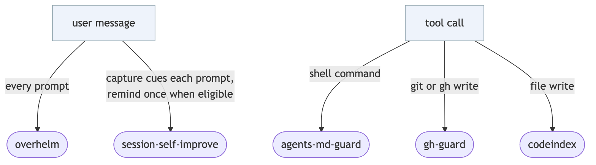
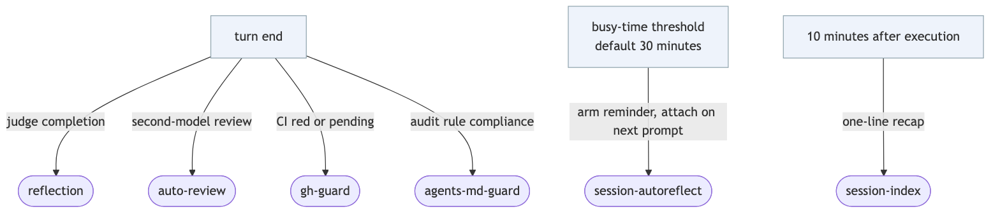
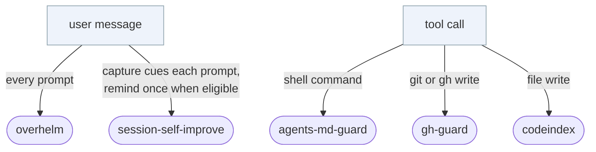
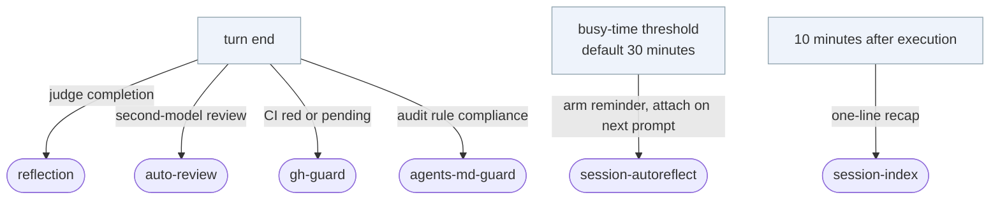
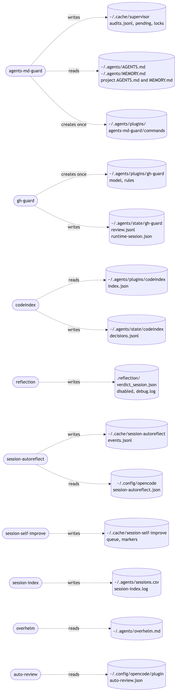
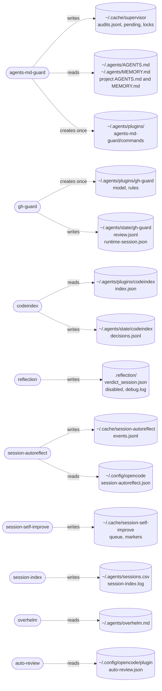

# Plugins in this repo

What runs, when it runs, what it touches on disk, and why it exists. This is a plugin map, not a
service map: the stage boxes (user message, tool call, turn end) are time anchors, not services.

## When they run

Before and during a turn:

After the turn:

Mermaid source

## What they read and write

Mermaid source

## The plugins

| Plugin | Runs on | Writes or changes on disk | Why you need it |
|---|---|---|---|
| agents-md-guard | turn end, and before every shell command on its list | `~/.cache/supervisor/` (audit log, pending notes, locks); creates `~/.agents/plugins/agents-md-guard/commands` | Judges the turn against `AGENTS.md` and `MEMORY.md` and blocks a configured command that breaks a rule |
| gh-guard | before a git or gh write, and at turn end | `~/.agents/plugins/gh-guard/` (model, rules, created once); `~/.agents/state/gh-guard/` (review log, per-session state) | Blocks the turn while CI for a commit this session pushed is red or pending, and checks writes against the review rules |
| codeindex | before a write or edit | creates `~/.agents/plugins/codeindex/` index files when built; appends `~/.agents/state/codeindex/decisions.jsonl` | Warns before a new exported declaration duplicates one an indexed repo already provides |
| reflection | turn end | `.reflection/verdict_<session>.json`, `.reflection/disabled`, `.reflection/debug.log` when debug is on | Re-prompts the agent until tests, PR and CI evidence are really there |
| auto-review | turn end | reads `~/.config/opencode/plugin/auto-review.json`; no state of its own | A second model looks for completion, test and CI gaps |
| session-autoreflect | after 30 minutes of busy time, per interval | `~/.cache/session-autoreflect/events.jsonl`; reads `~/.config/opencode/session-autoreflect.json` | Re-anchors the agent on the goal during long work |
| session-self-improve | once per session, after 3 actions | `~/.cache/session-self-improve/queue/` and `markers/` | Turns what the session learned into skill, AGENTS.md or memory updates |
| session-index | about 10 minutes after an execution ends | appends `~/.agents/sessions.csv` and `~/.agents/session-index.log` | Searchable one-line recaps across sessions |
| overhelm | every prompt | reads `~/.agents/overhelm.md`; no writes | Keeps replies short and plain |

Single-file plugins at the repo root:

| Plugin | Runs on | Writes on disk | Why you need it |
|---|---|---|---|
| `tts.ts` | agent finishes | `~/.config/opencode/opencode-helpers/tts.log` | Reads the final reply aloud |
| `telegram.ts` | agent finishes | nothing local; posts through Supabase | Two-way Telegram notifications and replies |
| `worktree.ts` | when the agent calls its tool | nothing | Git worktree status for the session |
| `opencode-auto-limit-nudge.ts` | a run dies on a usage limit | `~/.cache/opencode-auto-limit-resume/state.json` | Resumes the task on a fallback model or after backoff |
| `github.ts` | agent messages and GitHub comments | nothing local | Mirrors the session to a GitHub issue or PR |
| `sentry.ts` | an error | nothing local | Sends plugin errors to Sentry |

## Notes

- Install paths and model files: opencode reads `~/.config/opencode/opencode.json`; each judge plugin
  reads its model from `~/.agents/plugins/<name>/model`.
- The prompt evals are disabled for now (`npm run eval:*` prints a skip), so nothing here depends on
  them.
